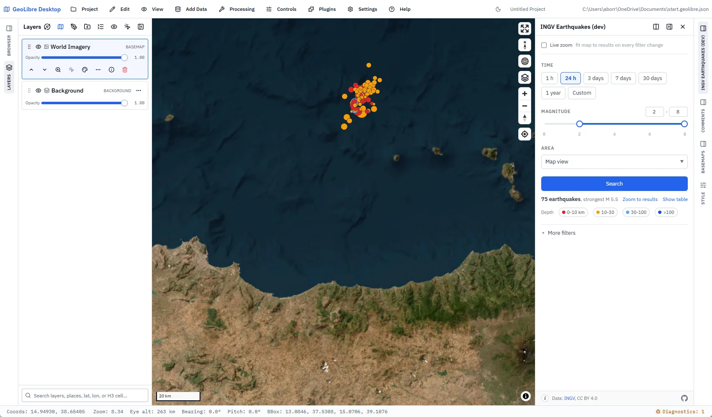
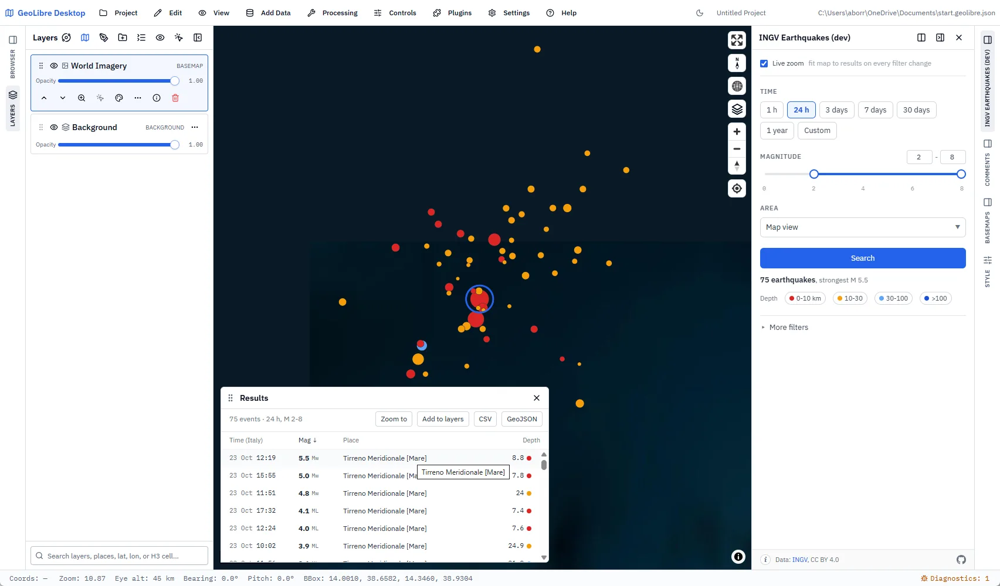
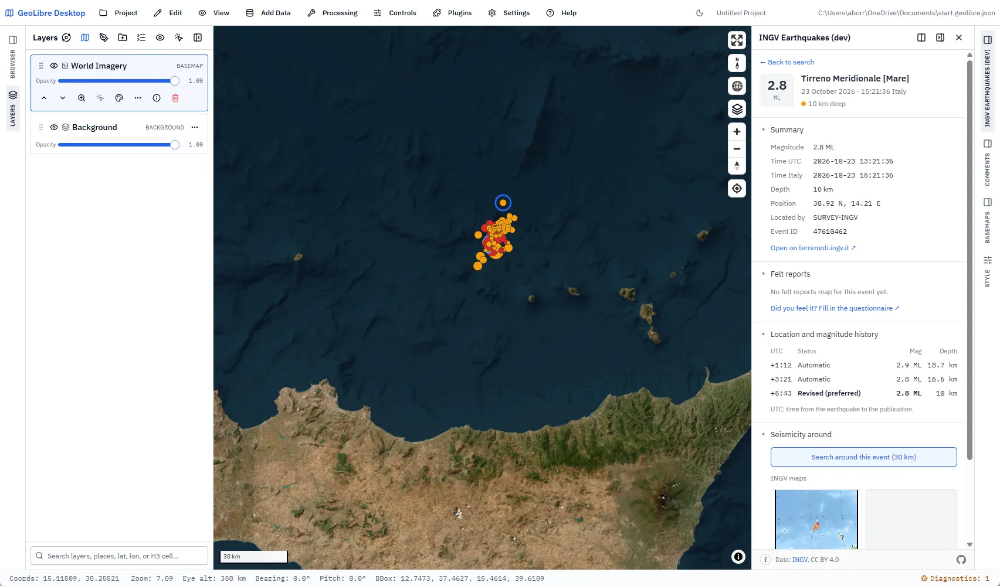

# INGV Earthquakes for GeoLibre

**The earthquakes of the last hour, day, week or year, on the map, from the Italian national catalogue.**

INGV (Istituto Nazionale di Geofisica e Vulcanologia) locates every earthquake recorded by the Italian seismic network and publishes it in its catalogue. This plugin brings that catalogue into [GeoLibre](https://github.com/opengeos/GeoLibre), the free GIS that runs in the browser and on the desktop: pick a period and a magnitude range, and the events appear on the map, coloured by depth and sized by magnitude.



Status: **beta**, open for testing.

## What it does

- **Search**: period (1 hour to 1 year, or a custom range with time), magnitude range, area (the map view, around a point, the whole world, or one of 173 countries), depth classes, order and limit. Every change runs a new search on the INGV service.
- **Map**: one circle per event, colour by depth (0-10, 10-30, 30-100, over 100 km), size by magnitude. A click opens the event. **Live zoom** fits the map to the results at every change. On wide screens the plugin opens GeoLibre's Minimap with a wider overview than its default (GeoLibre web, and Desktop from 3.5.0).
- **Results table**: sortable, hover to find the event on the map, export to CSV or GeoJSON, **Add to layers** to keep a search in the project.
- **Charts**: next to the table, three tabs. **Time**: events per hour, day or week with the running total, or the sequence of magnitudes over time; drag across it to search that period. **Magnitude**: events per class of 0.5. **Energy**: each class's share of the events and of the energy released. Hover a bar or a class to light up its events on the map. Under the result count, a small preview of the time chart opens them. Not on small screens for now.
- **Event detail**: time in Italy and UTC, position, depth, magnitude type; the ShakeMap maps when INGV made one; the felt reports map; how location and magnitude changed after the first estimate; a search of the seismicity around the event; a link to the event page on [terremoti.ingv.it](https://terremoti.ingv.it).
- **Share**: the Share button at the bottom of the panel gives a GeoLibre web link that opens the same search for anyone: period, magnitude, depth, area (the exact box of the map view, the point and radius, or the country), order and limit, plus the event when one is open. A preset period stays relative: a "24 h" link shows the last 24 hours when it is opened. In GeoLibre web the address bar follows the search too, so it can be copied as it is.
- **Small screens**: below 768 px, where GeoLibre docks the panel under the map, the results become a list with Results and Filters tabs.

- **AI Assistant**: GeoLibre's AI Assistant can drive the panel. Ask, in your own words, "i terremoti più forti in Italia nell'ultima settimana", "c'è stato un terremoto vicino a Napoli oggi?", "apri il più forte: c'è la ShakeMap?", "salvalo come layer": the assistant searches, opens the event or keeps the search as a layer through the panel, and you see it happen. Three tools (`search_earthquakes`, `open_event`, `add_to_layers`) and a short guidance text; the assistant also turns the plugin on by itself (GeoLibre web, and Desktop from 3.5.0; with Desktop 3.4.0 turn it on first from the Plugins menu).





## Install it in GeoLibre

You need [GeoLibre](https://github.com/opengeos/GeoLibre/releases) 3.4.0 or later.

1. In GeoLibre open **Settings > Manage Plugins**.
2. Find **INGV Earthquakes** and choose **Install**.
3. Turn the plugin on from **Plugins > INGV Earthquakes**: the panel opens with the earthquakes of the last 7 days, magnitude 2 and above, in the map view.

## Links

A link can also be written by hand. Every parameter is optional; the ones left out keep their default.

| Parameter | Value | Example |
| --- | --- | --- |
| `ingvTime` | `1h`, `24h`, `3d`, `7d`, `30d`, `1y`, `custom` | `ingvTime=24h` |
| `ingvFrom`, `ingvTo` | with `custom`, UTC minute | `ingvFrom=2026-10-01T00:00Z` |
| `ingvMag`, `ingvDepth` | min,max (magnitude 0-8, depth 0-700 km) | `ingvMag=3,8` |
| `ingvDepthOff` | depth classes hidden, by their top (0, 10, 30, 100) | `ingvDepthOff=100` |
| `ingvArea` | `view`, `around`, `world`, `country` | `ingvArea=world` |
| `ingvBox` | with `view`: west,south,east,north | `ingvBox=12,36,16,39` |
| `ingvCentre`, `ingvRadius` | with `around`: lat,lon and km | `ingvCentre=42.35,13.4&ingvRadius=50` |
| `ingvCountry` | with `country`: ISO code | `ingvCountry=GR` |
| `ingvOrder` | `time`, `time-asc`, `magnitude`, `magnitude-asc` | `ingvOrder=magnitude` |
| `ingvLimit` | number of events | `ingvLimit=200` |
| `ingvEvent` | event id, opens its detail | `ingvEvent=47616612` |
| `ingvLive` | `0`: live zoom off | `ingvLive=0` |
| `ingvMinimap` | Minimap zoom relative to the map (default -6; lower is wider), or `off`; screens 768 px and wider | `ingvMinimap=-8` |

For example, the earthquakes of magnitude 4.5 and above of the last 30 days in Greece: `https://web.geolibre.app/?plugin=ingv-geolibre&ingvTime=30d&ingvMag=4.5,8&ingvArea=country&ingvCountry=GR`

## Good to know

- **Coverage**: the catalogue is detailed for Italy and its seas, down to the smallest events. Elsewhere INGV lists only the stronger earthquakes. Over the 30 days before 23 October 2026 the smallest event listed was M 0.1 in Italy, M 4.5 in the rest of Europe and the Mediterranean, M 5.5 in the rest of the world.
- **Web or Desktop**: the event search works in both. The ShakeMap layers (contours and stations as GeoJSON) are served without CORS headers, so only GeoLibre Desktop can add them to the map; the ShakeMap images show in both.
- **GeoLibre Desktop 3.5.0**: the panel shows without its styles, as do those of every external plugin; the search works. Fixed in GeoLibre 3.5.1 ([opengeos/GeoLibre#3210](https://github.com/opengeos/GeoLibre/issues/3210)): use 3.5.1 or later on Desktop.

## Data and citation

Events come from the INGV [FDSN event web service](https://webservices.ingv.it/fdsnws/event/1/), described on the [INGV web services page](https://terremoti.ingv.it/webservices_and_software). ShakeMap from [shakemap.ingv.it](https://shakemap.ingv.it), felt reports from [hsit.it](https://www.hsit.it), country boxes from [Natural Earth](https://www.naturalearthdata.com) 1:110m. The data are released by INGV under the [Creative Commons Attribution 4.0](https://creativecommons.org/licenses/by/4.0/) licence.

Cite the catalogue as: ISIDe Working Group (2007). Italian Seismological Instrumental and Parametric Database (ISIDe). Istituto Nazionale di Geofisica e Vulcanologia (INGV). [doi:10.13127/ISIDE](https://doi.org/10.13127/ISIDE)

## Development

```bash
npm install
npm test
npm run build              # geolibre-plugin/dist
npm run build:geolibre:dev # development copy, id ingv-geolibre-dev, in geolibre-plugin-dev/
npm run package:geolibre   # zip in geolibre-plugin/
```

The build, packaging and install scripts come from [openrndt-geolibre](https://github.com/ondata/openrndt-geolibre). The design notes are in [docs/ui-design.md](docs/ui-design.md), the history in [LOG.md](LOG.md).

## Licence

Code: MIT, see [LICENSE](LICENSE). Data: INGV, CC BY 4.0.
